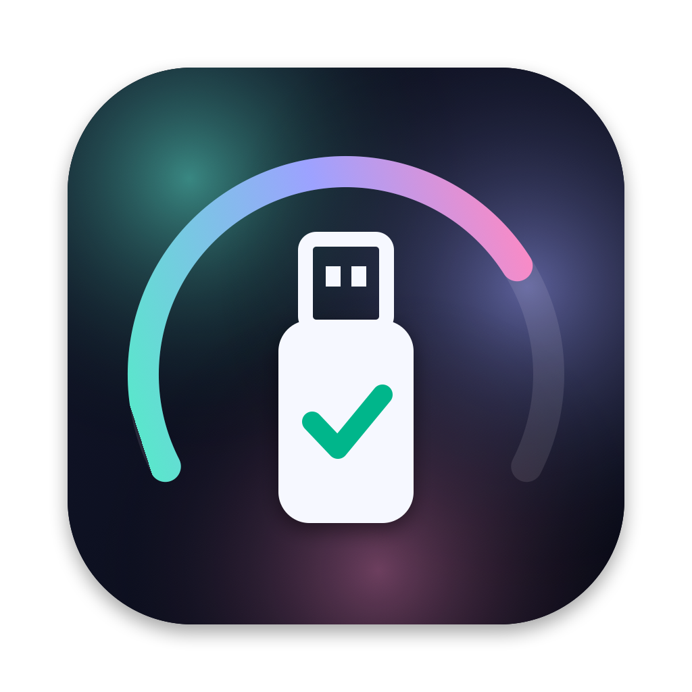
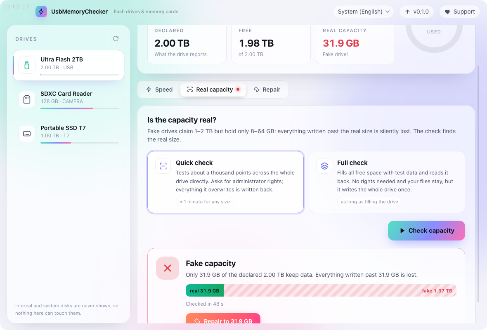
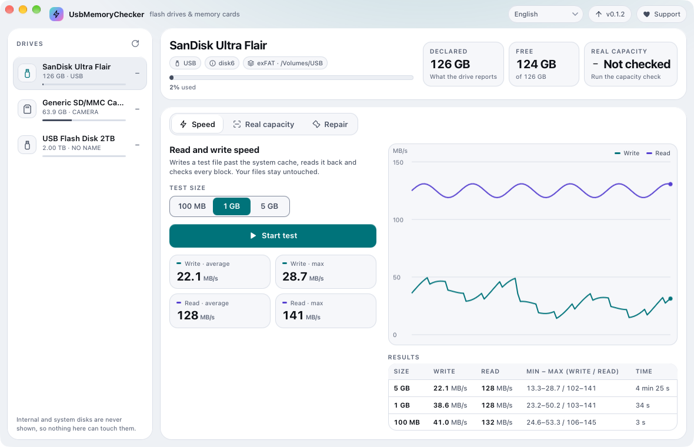

# UsbMemoryChecker

**Check USB flash drives and memory cards: real read/write speed, real capacity, and repair of fake drives.**

macOS (Apple Silicon) and Windows · English, Русский, Español, Deutsch, 中文 · free

[Русская версия](README.ru.md)



## What it does

- **Speed test.** Writes and reads 100 MB, 1 GB or 5 GB past the system cache, so you see the speed of the drive
  and not of your computer's memory. Shows average, maximum and minimum write and read speed, a live chart and a
  table of all runs. Every block read back is checked, so a drive that corrupts data is caught too.
- **Real capacity.** Cheap "1 TB / 2 TB" flash drives and microSD cards often hold only 8–64 GB: the controller
  lies about the size, and everything written past the real size is silently lost. Two ways to find the truth:
  - **Quick check** — about a minute for any size, even 2 TB. Tests ~1000 points across the whole device directly
    (like `f3probe`), finds the exact boundary to 1 MB. Asks for administrator rights. Everything it overwrites is
    read first and written back at the end, so your files survive.
  - **Full check** — fills all free space with test files and reads them back (like H2testw). No rights needed.
    On a genuine drive your files stay and it takes as long as writing the whole free space. It reads back samples
    after every 1 GB (about 1.6% extra reading), and on a fake drive it stops shortly (within about 1-2 GB) after the
    drive starts losing data, then verifies what was written. After such an early stop only the written part is
    checked. **On a fake drive files that are already on it can be damaged** (once the test data passes the real size,
    the drive may write it over the start of the drive), so back them up first; the quick check does not have this
    problem because it restores everything it overwrites.
- **Repair.** Gives a fake drive a size it can really hold:
  - It makes one partition of the *real* size (exFAT or FAT32) and leaves the fake part unused. The drive then
    honestly shows, say, 31.9 GB and stops losing files.
  - **Repair erases the drive.**
  - Afterwards the window offers the full check of the repaired drive, to confirm the new size is right.
  - The proposed size is the real size known from a check, or else the size of the current partition.
  - The full declared size is used only if you tick **Use the full declared size**.
  - The full declared size is proposed by default only for a drive that a whole-device check found genuine.
  - A drive that is not checked yet gets no proposed size: run the quick check, or tick the full size yourself.
  - For a repaired drive, the last check result and the repair are saved in `capacity.json` next to the settings, so it
    still shows "Repaired" after a restart or a replug.
  - A drive that was only checked, not repaired, is not remembered after a replug or a restart: check it again.
  - A repaired drive is recognised by its declared size and partition layout.
  - A drive whose partition ends far before its declared size is shown as "limited", even without a saved result.
- **Capacity at a glance.** A capacity map of the selected drive shows the used and free space and the fake part, next
  to the declared size, the free space and the verified real size.
- **Safe by design.** Only removable and external drives are listed (never internal or system disks), and right before
  touching one the elevated part checks again that its id, size and partition layout are the same. To be on the safe
  side, a drive whose partitions end well before its declared size (say, a stick written with `dd` from an ISO image)
  is shown as "limited", with that size as the proposed repair size. A small GPT stick partitioned by macOS may show
  "partition verified" instead of a verified whole device; a quick check settles both cases. If what the app knew no
  longer matches the partitions (another drive took its place) or the layout cannot be read, the header says
  "Unconfirmed" and the app asks for a quick check before it proposes a repair size.
- **Updates itself** from GitHub releases (checked once a day, can be turned off) and has a **Support** button.

Everything is on one screen: the drives are on the left; the selected drive's capacity map (used, free, fake part; the
declared, free and real size) is on top; below it are the **Speed**, **Real capacity** and **Repair** tabs, each with
the settings on the left and the result on the right (in a small window they stack). Light and dark follow the system.



*The screenshots show example drives.*

## Install

Download the latest release from [Releases](https://github.com/DeMoZ/UsbMemoryChecker/releases/latest):

- **macOS (Apple Silicon):** `UsbMemoryChecker-macOS-v<version>.dmg` — open it and drag the app to Applications.
  The app is not notarized: on the first start right-click it → **Open**, or run
  `xattr -dr com.apple.quarantine /Applications/UsbMemoryChecker.app`.
- **Windows 10/11 (x64):** `UsbMemoryChecker-<version>-windows-x64.zip` — unpack and run `UsbMemoryChecker.exe`.
  The WebView2 runtime is built into Windows 11 and current Windows 10.

## How to use

1. Insert the flash drive or card. It appears in the list on the left by itself.
2. **Speed** tab: choose 100 MB, 1 GB or 5 GB and press **Start test**.
3. **Real capacity** tab: choose **Quick check** (recommended) or **Full check** and press **Check capacity**.
   For the quick check macOS asks for your password, Windows asks for permission.

   **macOS: Full Disk Access.** macOS may block direct access to drives for an app without Full Disk Access, even
   after the password. The window then says so and has a button that opens the setting. Turn UsbMemoryChecker on in
   **System Settings → Privacy & Security → Full Disk Access**, then quit the app and open it again. The app is not
   signed with a stable identity, so after an update you may have to remove it from that list and add it again.
4. If the drive turns out fake, press **Repair to …**: choose exFAT or FAT32 and a name, and confirm. For how the
   size is chosen, see the **Repair** points above. **This erases the drive** — copy your files off it first.

## How the quick check works

A fake drive maps the addresses past its real size either back onto the real part (usually by ignoring the high
address bits) or nowhere at all (writes are lost, reads give zeros or garbage); some also keep recent writes in a
small cache. The probe writes a unique pattern, computed from the address, to points on a power-of-two grid over the
whole device plus their likely wrap-around targets, from the highest address down; then writes 16 MB at the start to
flush any cache, and reads every point back. A point whose data came back different is not real. Between the last
good and the first bad point it repeats with a finer grid until the boundary is known to 1 MB.

**Your data.** No block is written before its old content has been read and kept: a block that cannot be read is not
written at all. At the end, also after a cancel or an error, everything is written back in reverse order. The drive
is then asked to flush its cache, and the start of the drive (its first 16 MB and last 1 MB) and every block of the
first round are read again and compared with what was there before the first write. Blocks that only the later,
finer rounds wrote are put back but not read again. After the drive is closed and mounted again, its partition layout
is compared with the one from before. A matching re-read only shows that the drive answers with the old data now; it
may come from the drive's own memory, and only unplugging it and reading again shows what is on the flash.

**Stopped answering is not "keeps no data".** Points whose data came back different are counted apart from points
where a read or a write returned an error. If the drive stops answering (the first point or the start of the drive
fails with an error), the check ends without a verdict. "The drive keeps no data" is said only when data really came
back different while the start of the drive still answers.

**When to unplug.** If the drive stopped answering, a block could not be written back or reads back different, or the
partition layout changed or vanished, the result is not saved. The window asks you to unplug the drive, plug it in
again and check it again, and until the drive has left the list the app starts nothing on it. **Do not format,
initialize or repair it first, even if the system offers to.**

Very unusual controllers that wrap by a non-power-of-two size may slip past the quick check — the full check catches
everything, because it really writes the free space and reads it back, stopping shortly (within about 1-2 GB) after
the drive starts losing data; after an early stop only the written part is checked.

## Reports

Every quick check, full check and repair leaves a small JSON report, also when it failed or was cancelled:
`~/Library/Logs/UsbMemoryChecker/checks/` on macOS, `%LOCALAPPDATA%\UsbMemoryChecker\logs\checks\` on Windows.
**Show report** on the **Real capacity** tab opens the folder at the last report of the selected drive; the command
line prints its path. A report holds the stages, error codes and positions, counts, the read-back and layout checks,
the drive's model, size and partition offsets, sizes and file systems. It never holds your files or data read from
the drive (or digests of it), volume names, mount paths, volume UUIDs, disk identifiers, serial numbers, your user
name or home folder. The newest 50 reports are kept, none older than 90 days. Nothing is sent anywhere.

## Build from source

Needs [Rust](https://rustup.rs) (edition 2024).

```bash
cargo run --release           # run the app
cargo test                    # tests (the probe is tested against simulated fake drives)
scripts/build-macos.sh        # macOS: dist/UsbMemoryChecker.app, .dmg and the update .zip
```

Command line without the window (JSON output):

```bash
usbmemorychecker --cli list
usbmemorychecker --cli speed disk4 1000
usbmemorychecker --cli probe disk4
usbmemorychecker --cli full disk4
```

Built with [tao](https://github.com/tauri-apps/tao) + [wry](https://github.com/tauri-apps/wry) (system WebView),
no runtime besides the OS.

## Support

UsbMemoryChecker is free. If it saved you from a fake drive or lost files, the **Support** button in the app shows
ways to support its development.

## License

[MIT](LICENSE)
