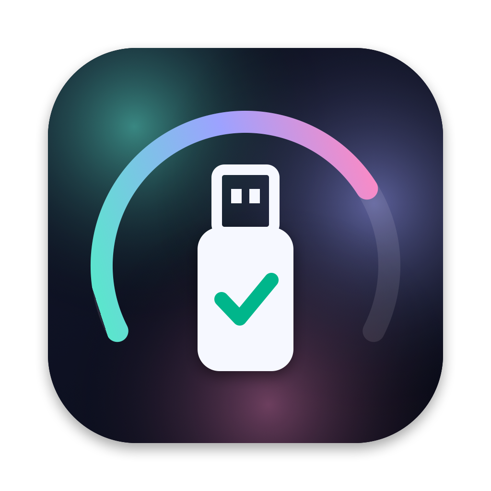
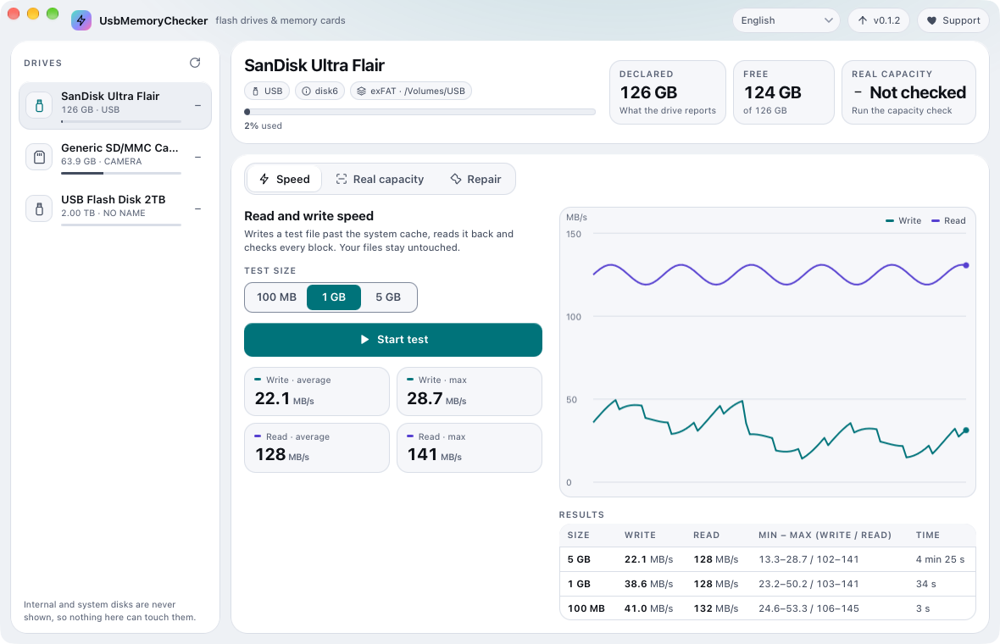

# UsbMemoryChecker

**Проверка USB-флешек и карт памяти: настоящая скорость чтения и записи, реальный объём и исправление поддельных
носителей.**

macOS (Apple Silicon) и Windows · English, Русский, Español, Deutsch, 中文 · бесплатно

[English version](README.md)


## Что умеет

- **Тест скорости.** Пишет и читает 100 МБ, 1 ГБ или 5 ГБ мимо системного кэша, поэтому видна скорость носителя, а
  не памяти компьютера. Показывает среднюю, максимальную и минимальную скорость записи и чтения, живой график и
  таблицу всех запусков. Каждый прочитанный блок сверяется, так что носитель, который портит данные, тоже виден.
- **Реальный объём.** Дешёвые флешки и microSD на «1 ТБ / 2 ТБ» часто вмещают 8–64 ГБ: контроллер врёт про
  размер, а всё, что записано сверх реального объёма, молча теряется. Два способа узнать правду:
  - **Быстрая проверка** — около минуты при любом объёме, даже 2 ТБ. Напрямую проверяет ~1000 точек по всему
    носителю (как `f3probe`) и находит точную границу с точностью до 1 МБ. Нужны права администратора. Всё, что
    перезаписывается, сначала читается и в конце возвращается на место, поэтому ваши файлы остаются.
  - **Полная проверка** — заполняет всё свободное место тестовыми файлами и читает их обратно (как H2testw). Права не
    нужны. На настоящем носителе ваши файлы остаются, а идёт столько, сколько записывать всё свободное место. После
    каждого 1 ГБ читает обратно выборочные участки (около 1,6% дополнительного чтения), а на поддельном
    останавливается вскоре (примерно через 1-2 ГБ) после того, как носитель начал терять данные, затем проверяет
    записанное. После такой ранней остановки проверена только записанная часть. **На поддельном носителе файлы,
    которые уже на нём лежат, могут быть повреждены** (когда тестовые данные проходят реальный объём, носитель может
    писать их поверх начала диска), поэтому сначала сделайте копию; быстрая проверка так не делает: она возвращает
    всё, что перезаписала.
- **Исправление.** Даёт поддельному носителю размер, который он действительно вмещает:
  - Создаётся один раздел на *реальный* объём (exFAT или FAT32), поддельная часть остаётся неиспользованной. После
    этого флешка честно показывает, например, 31,9 ГБ и перестаёт терять файлы.
  - **Исправление стирает носитель.**
  - Затем окно предлагает полную проверку исправленного носителя, чтобы убедиться, что новый размер верен.
  - Предлагается реальный размер, известный по проверке, а если его нет — размер текущего раздела.
  - Весь заявленный объём используется, только если отметить **Использовать весь заявленный объём**.
  - По умолчанию весь объём предлагается только носителю, который проверка всего носителя признала настоящим.
  - Ещё не проверенному носителю размер не предлагается: запустите быструю проверку или отметьте весь объём сами.
  - Для исправленного носителя итог последней проверки и исправление сохраняются в `capacity.json` рядом с
    настройками, поэтому он и после перезапуска или переподключения показывается как «Исправлен».
  - Носитель, который только проверяли, но не исправляли, после переподключения или перезапуска не помнится:
    проверьте его заново.
  - Исправленный носитель узнаётся по заявленному объёму и разметке разделов.
  - Носитель, у которого раздел заканчивается намного раньше заявленного объёма, показывается как «ограничен» даже
    без сохранённого результата.
- **Объём с первого взгляда.** Карта ёмкости выбранного носителя показывает занятое и свободное место и поддельную
  часть, рядом — заявленный объём, свободное место и проверенный реальный объём.
- **Безопасно.** В списке только съёмные и внешние носители (внутренних и системных дисков там нет), а часть с правами
  администратора прямо перед работой ещё раз проверяет, что номер, размер и разметка разделов те же. Ради
  безопасности носитель, у которого разделы заканчиваются намного раньше заявленного объёма (например, флешка,
  записанная через `dd` из образа ISO), показывается как «ограничен», а для исправления предлагается этот размер.
  Маленькая GPT-флешка, размеченная в macOS, может показаться как «раздел проверен», а не «весь носитель проверен»;
  быстрая проверка проясняет оба случая. Если то, что программа знала о носителе, больше не совпадает с его разделами
  (на его месте другой носитель) или разметку не удаётся прочитать, в заголовке написано «Не подтверждено», и
  программа просит быструю проверку, прежде чем предлагать размер для исправления.
- **Обновляется сама** из релизов GitHub (проверка раз в сутки, можно выключить), есть кнопка **Поддержать**.

Всё помещается на одном экране: слева носители; сверху карта ёмкости выбранного носителя (занято, свободно, поддельная
часть; заявленный, свободный и реальный объём); под ней вкладки **Скорость**, **Реальный объём** и **Исправление**, на
каждой слева настройки, справа результат (в маленьком окне — друг под другом). Светлая и тёмная темы следуют за
системой.



*На снимках — примеры носителей.*

## Установка

Скачайте последний релиз со страницы [Releases](https://github.com/DeMoZ/UsbMemoryChecker/releases/latest):

- **macOS (Apple Silicon):** `UsbMemoryChecker-macOS-v<версия>.dmg` — откройте и перетащите программу в
  «Программы». Программа не нотаризована: при первом запуске — правый клик → **Открыть**, или
  `xattr -dr com.apple.quarantine /Applications/UsbMemoryChecker.app`.
- **Windows 10/11 (x64):** `UsbMemoryChecker-<версия>-windows-x64.zip` — распакуйте и запустите
  `UsbMemoryChecker.exe`. WebView2 уже есть в Windows 11 и в актуальной Windows 10.

## Как пользоваться

1. Вставьте флешку или карту — она сама появится в списке слева.
2. Вкладка **Скорость**: выберите 100 МБ, 1 ГБ или 5 ГБ и нажмите **Начать тест**.
3. Вкладка **Реальный объём**: выберите **Быструю проверку** (рекомендуется) или **Полную** и нажмите
   **Проверить объём**. Для быстрой проверки macOS спросит пароль, Windows — разрешение.

   **macOS: полный доступ к диску.** macOS может не давать прямого доступа к дискам программе без полного доступа к
   диску, даже после пароля. Тогда окно сообщает об этом и показывает кнопку, открывающую настройку. Включите
   UsbMemoryChecker в **Системные настройки → Конфиденциальность и безопасность → Полный доступ к диску**, затем
   закройте программу и откройте снова. У программы нет постоянной подписи, поэтому после обновления её, возможно,
   придётся удалить из этого списка и добавить снова.
4. Если носитель поддельный, нажмите **Исправить на …**: выберите exFAT или FAT32 и имя и подтвердите. Как
   выбирается размер, описано выше в пунктах об **исправлении**. **Носитель при этом стирается** — сначала скопируйте
   с него файлы.

## Как работает быстрая проверка

Поддельный носитель отображает адреса за реальным объёмом либо обратно на настоящую часть (обычно просто отбрасывая
старшие биты адреса), либо в никуда (запись теряется, чтение даёт нули или мусор); некоторые ещё держат последние
записи в маленьком кэше. Проверка пишет в точки на сетке степени двойки по всему носителю и в их вероятные «двойники»
уникальный узор, зависящий от адреса, — от старших адресов к младшим; затем пишет 16 МБ в начало, чтобы вытеснить
кэш, и читает все точки обратно. Точка, данные которой вернулись другими, не настоящая. Между последней хорошей и
первой плохой точкой всё повторяется на сетке мельче, пока граница не известна с точностью до 1 МБ.

**Ваши данные.** Ни один блок не перезаписывается, пока его старое содержимое не прочитано и не сохранено: блок,
который не читается, вообще не записывается. В конце, также после отмены или ошибки, всё записывается обратно в
обратном порядке. Затем носитель получает команду сбросить кэш, и начало носителя (первые 16 МБ и последний 1 МБ) и
все блоки первого прохода читаются снова и сравниваются с тем, что было до первой записи. Блоки, которые писали
только следующие, уточняющие проходы, возвращаются, но не перечитываются. Когда носитель закрыт и снова подключён,
разметка разделов сравнивается с прежней. Совпавшее повторное чтение показывает лишь то, что сейчас носитель отвечает
старыми данными; они могут браться из его собственной памяти, и что лежит во флеш-памяти, покажет только
переподключение и новое чтение.

**«Перестал отвечать» — не «не хранит данные».** Точки, данные которых вернулись другими, считаются отдельно от точек,
где чтение или запись вернули ошибку. Если носитель перестал отвечать (первая точка или начало носителя дают ошибку),
проверка заканчивается без вердикта. «Носитель не хранит данные» говорится, только когда данные действительно
вернулись другими, а начало носителя всё ещё отвечает.

**Когда вынимать носитель.** Если носитель перестал отвечать, блок не удалось записать обратно или он читается иначе,
а также если разметка разделов изменилась или пропала, результат не сохраняется. (Если таблицу разделов не удалось
прочитать ещё до проверки, сравнивать не с чем, и решает только повторное чтение. Проверка, которая ничего не
записала, не просит вынуть носитель из-за разметки.) Окно просит вынуть носитель,
вставить снова и проверить заново, и пока носитель не пропал из списка, программа ничего на нём не запускает.
**До этого не форматируйте, не инициализируйте и не исправляйте его, даже если это предлагает система.**

Очень редкие контроллеры, которые «заворачивают» адреса по размеру, не равному степени двойки, могут пройти быструю
проверку — полная проверка ловит всё, потому что действительно пишет свободное место и читает его обратно, останавливаясь вскоре
(примерно через 1-2 ГБ) после того, как носитель начал терять данные; после ранней остановки проверена только
записанная часть.

## Отчёты

Каждая быстрая проверка, полная проверка и исправление оставляют небольшой отчёт в JSON, также при ошибке или отмене:
`~/Library/Logs/UsbMemoryChecker/checks/` в macOS, `%LOCALAPPDATA%\UsbMemoryChecker\logs\checks\` в Windows.
**Показать отчёт** на вкладке **Реальный объём** открывает папку на последнем отчёте проверки выбранного носителя; командная
строка печатает путь к нему. В отчёте есть этапы, коды и позиции ошибок, счётчики, итоги повторного чтения и проверки
разметки, модель и объём носителя, смещения, размеры и файловые системы разделов. В нём никогда нет ваших файлов и
прочитанных с носителя данных (и их контрольных сумм), названий томов, путей подключения, UUID томов, идентификаторов
диска, серийных номеров, имени пользователя и домашней папки. Хранятся 50 новейших отчётов, не старше 90 дней. Никуда
ничего не отправляется.

## Сборка из исходников

Нужен [Rust](https://rustup.rs) (edition 2024).

```bash
cargo run --release           # запустить программу
cargo test                    # тесты (быстрая проверка гоняется на имитациях поддельных носителей)
scripts/build-macos.sh        # macOS: dist/UsbMemoryChecker.app, .dmg и .zip для обновления
```

Командная строка без окна (ответ в JSON):

```bash
usbmemorychecker --cli list
usbmemorychecker --cli speed disk4 1000
usbmemorychecker --cli probe disk4
usbmemorychecker --cli full disk4
```

## Поддержать

UsbMemoryChecker бесплатный. Если он уберёг вас от поддельной флешки или потерянных файлов, кнопка **Поддержать** в
программе покажет, как поддержать его развитие.

## Лицензия

[MIT](LICENSE)
