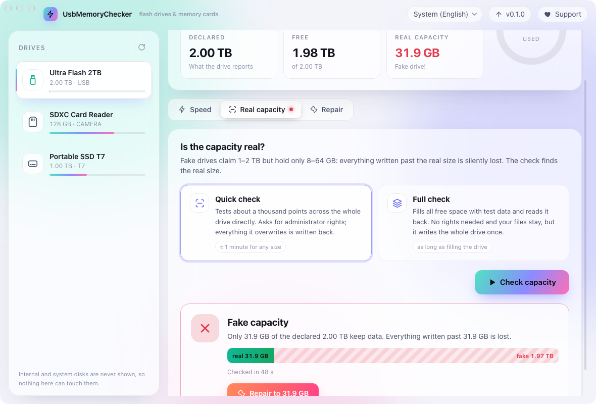

# UsbMemoryCheker

**Проверка USB-флешек и карт памяти: настоящая скорость чтения и записи, реальный объём и исправление поддельных
носителей.**

macOS (Apple Silicon) и Windows · English, Русский, Español, Deutsch, 中文 · бесплатно

[English version](README.md)



## Что умеет

- **Тест скорости.** Пишет и читает 100 МБ, 1 ГБ или 5 ГБ мимо системного кэша, поэтому видна скорость носителя, а
  не памяти компьютера. Показывает среднюю, максимальную и минимальную скорость записи и чтения, живой график и
  таблицу всех запусков. Каждый прочитанный блок сверяется, так что носитель, который портит данные, тоже виден.
- **Реальный объём.** Дешёвые флешки и microSD на «1 ТБ / 2 ТБ» часто вмещают 8–64 ГБ: контроллер врёт про
  размер, а всё, что записано сверх реального объёма, молча теряется. Два способа узнать правду:
  - **Быстрая проверка** — около минуты при любом объёме, даже 2 ТБ. Напрямую проверяет ~1000 точек по всему
    носителю (как `f3probe`) и находит точную границу с точностью до 1 МБ. Нужны права администратора. Всё, что
    перезаписывается, сначала читается и в конце возвращается на место, поэтому ваши файлы остаются.
  - **Полная проверка** — заполняет всё свободное место тестовыми файлами и читает их обратно (как H2testw). Права не
    нужны и файлы остаются, но идёт столько, сколько записывать весь носитель.
- **Исправление.** Переразмечает носитель: один раздел на *реальный* объём (exFAT или FAT32), поддельная часть
  остаётся неразмеченной. После этого флешка честно показывает, например, 31,9 ГБ и перестаёт терять файлы.
- **Показывает свободное и общее место** тома, заявленный объём и проверенный реальный.
- **Безопасно.** В списке только съёмные и внешние носители; внутренние и системные диски не показываются вовсе. Часть
  с правами администратора перед работой ещё раз проверяет носитель (тот же номер, тот же размер).
- **Обновляется сама** из релизов GitHub (проверка раз в сутки, можно выключить), есть кнопка **Поддержать**.


*На снимках — примеры носителей.*

## Установка

Скачайте последний релиз со страницы [Releases](https://github.com/DeMoZ/UsbMemoryChecker/releases/latest):

- **macOS (Apple Silicon):** `UsbMemoryCheker-macOS-v<версия>.dmg` — откройте и перетащите программу в
  «Программы». Программа не нотаризована: при первом запуске — правый клик → **Открыть**, или
  `xattr -dr com.apple.quarantine /Applications/UsbMemoryCheker.app`.
- **Windows 10/11 (x64):** `UsbMemoryCheker-<версия>-windows-x64.zip` — распакуйте и запустите
  `UsbMemoryCheker.exe`. WebView2 уже есть в Windows 11 и в актуальной Windows 10.

## Как пользоваться

1. Вставьте флешку или карту — она сама появится в списке слева.
2. Вкладка **Скорость**: выберите 100 МБ, 1 ГБ или 5 ГБ и нажмите **Начать тест**.
3. Вкладка **Реальный объём**: выберите **Быструю проверку** (рекомендуется) или **Полную** и нажмите
   **Проверить объём**. Для быстрой проверки macOS спросит пароль, Windows — разрешение.
4. Если носитель поддельный, нажмите **Исправить на …**: выберите exFAT или FAT32 и имя, подтвердите — и на носителе
   будет раздел реального размера. **Носитель при этом стирается** — сначала скопируйте с него файлы.

## Как работает быстрая проверка

Поддельный носитель отображает адреса за реальным объёмом либо обратно на настоящую часть (обычно просто отбрасывая
старшие биты адреса), либо в никуда (запись теряется, чтение даёт нули или мусор); некоторые ещё держат последние
записи в маленьком кэше. Проверка пишет в точки на сетке степени двойки по всему носителю и в их вероятные «двойники»
уникальный узор, зависящий от адреса, — от старших адресов к младшим; затем пишет 16 МБ в начало, чтобы вытеснить
кэш, и читает все точки обратно. Точка, данные которой вернулись другими, не настоящая. Между последней хорошей и
первой плохой точкой всё повторяется на сетке мельче, пока граница не известна с точностью до 1 МБ. Перед каждой
записью старое содержимое читается, а в конце всё записывается обратно в обратном порядке.

Очень редкие контроллеры, которые «заворачивают» адреса по размеру, не равному степени двойки, могут пройти быструю
проверку — полная проверка ловит всё, потому что действительно пишет и читает каждый байт свободного места.

## Сборка из исходников

Нужен [Rust](https://rustup.rs) (edition 2024).

```bash
cargo run --release           # запустить программу
cargo test                    # тесты (быстрая проверка гоняется на имитациях поддельных носителей)
scripts/build-macos.sh        # macOS: dist/UsbMemoryCheker.app, .dmg и .zip для обновления
```

Командная строка без окна (ответ в JSON):

```bash
usbmemorycheker --cli list
usbmemorycheker --cli speed disk4 1000
usbmemorycheker --cli probe disk4
usbmemorycheker --cli full disk4
```

## Поддержать

UsbMemoryCheker бесплатный. Если он уберёг вас от поддельной флешки или потерянных файлов, кнопка **Поддержать** в
программе покажет, как поддержать его развитие.

## Лицензия

[MIT](LICENSE)
